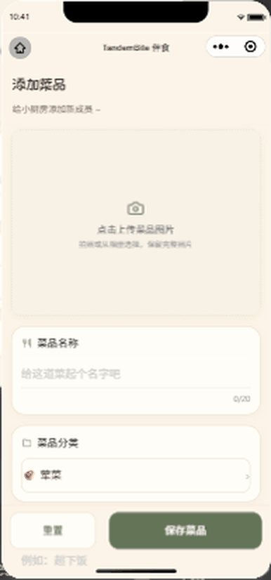

# TandemBite 伴食

> 一个为两个人设计的微信小程序「情侣小厨房」：一起管理菜品、每天点菜、记录吃喝与生活收支。
>
> 本仓库是 [PairBite](https://github.com/630999Steven/PairBite) 的**二次开发分支**，当前版本 **2.3.1（奶油手账）**。基于微信云开发，零服务器、零运维，开箱即用。

<p>
  <a href="LICENSE"></a>
  <a href="https://developers.weixin.qq.com/miniprogram/dev/framework/"></a>
  <a href="README.en-US.md"></a>
</p>

## 界面预览

<table>
  <tr>
    <td align="center"><br><b>首页</b><br>今日餐单与本月花费一览</td>
    <td align="center"><br><b>小厨房</b><br>两个人的菜谱抽屉</td>
    <td align="center"><br><b>点菜</b><br>分类选菜、一键存餐单</td>
    <td align="center"><br><b>菜品库</b><br>搜索、收藏与常做排序</td>
  </tr>
  <tr>
    <td align="center"><br><b>生活账本</b><br>收支明细与筛选</td>
    <td align="center"><br><b>分类统计</b><br>环形图看钱花在哪</td>
    <td align="center"><br><b>点菜历史</b><br>按日期回看每一餐</td>
    <td align="center"><br><b>添加菜品</b><br>照片、分类与描述</td>
  </tr>
</table>

> 以上均为 2.3.1 奶油手账主题的真实运行截图（微信开发者工具「iPhone 12/13 Pro」模拟器，390×844）。
> 截图中的菜品与金额来自开发账号的演示数据。

## 功能概览

**核心功能（继承自上游 PairBite）**

- **伴侣绑定**：通过邀请码配对，绑定后双方数据自动同步
- **菜品库管理**：添加 / 编辑菜品，支持分类、图片、描述与菜谱步骤
- **每日点菜**：从菜品库选菜下单，支持备注，伴侣实时收到通知
- **历史记录**：查看全部点菜历史，支持「再来一单」快速复用
- **分类管理**：自定义菜品分类（荤菜 / 素菜 / 汤品 / 主食等）并排序
- **订阅通知**：点菜后向伴侣推送微信订阅消息
- **厨房命名**：自定义小厨房名称，双方同步显示

**本分支新增（2.1 → 2.3.1）**

- **奶油手账主题**：统一的主题变量、手账风表面与轻量动效，标题使用本地字体子集
- **唯一厨房**：一个人的厨房也能用，绑定不再是使用前提；绑定合并、解绑复制都有事务保护
- **生活账簿**：收入 / 支出记账、月度与自定义区间统计、分类占比、CSV 导出
- **环形分类统计**：原生 2D 画布绘制的分类占比环，按整数分计算角度，零支出不生成占比
- **小狗互动与页内反馈**：保存成功的轻量反馈，不阻塞交互、不接收指针事件
- **表单草稿**：编辑中的表单与待选餐单自动暂存，意外退出后可恢复
- **共同收藏与常做排序**：收藏在双方之间共享，常做菜品按点菜次数排序
- **完整照片预览**：菜品照片等比缩放上传，列表与大图预览都保留完整画面
- **性能优化**：首页 / 厨房 / 点菜 / 账本各合并为一次聚合请求，图片链接随响应返回

## 技术栈

| 层 | 技术 | 说明 |
|---|---|---|
| 前端 | 微信小程序原生 | WXML + WXSS + JS，无新增前端运行依赖 |
| UI | WeUI + 自绘组件 | 微信官方组件库，另有 `ledger-ring` 画布组件 |
| 后端 | 微信云函数 | Node.js（Nodejs20.19）+ wx-server-sdk |
| 数据库 | 微信云数据库 | NoSQL 文档数据库，按厨房 / `coupleId` 隔离 |
| 存储 | 微信云存储 | 菜品照片 |
| 通知 | 微信订阅消息 | 点菜 / 新菜品通知 |

无第三方 API 依赖，完整运行在微信云开发生态内。

## 目录结构

```
.
├── miniprogram/                 # 小程序前端
│   ├── app.js                   # 全局逻辑（用户、绑定守卫、云初始化、通知模板）
│   ├── app.json                 # 页面路由与 TabBar（首页 / 厨房 / 账本 / 我的）
│   ├── app.wxss                 # 全局主题变量与基础样式
│   ├── envList.js               # 云环境配置 ← 需要修改
│   ├── components/
│   │   ├── bind-guard/          # 绑定状态提醒
│   │   └── ledger-ring/         # 分类占比环形图（原生 2D 画布）
│   ├── pages/                   # 14 个页面：MainPage、Kitchen、Order、Dishes、
│   │                            #   DishAdd、DishDetail、RecipeEdit、Ledger、
│   │                            #   LedgerEdit、OrderHistory、OrderDetail、
│   │                            #   CategoryManage、Bind、Settings
│   ├── styles/                  # 手账主题、统一表面与反馈样式
│   ├── templates/               # 页内反馈模板
│   ├── utils/                   # ledger、ring、drafts、feedback、dish-tools 等纯函数
│   └── images/                  # 图标与插图（Lucide 本地 PNG）
├── cloudfunctions/              # 11 个云函数
│   ├── tandem/                  # 聚合接口（view / 业务写操作 / 事务）
│   ├── createUser/              # 注册登录、生成邀请码
│   ├── bindPartner/             # 伴侣绑定
│   ├── unbindPartner/           # 解除绑定
│   ├── getCoupleData/           # 查询共享数据
│   ├── updateCoupleData/        # 更新 / 删除共享数据
│   ├── manageCategory/          # 分类管理
│   ├── updateKitchenName/       # 厨房命名
│   ├── sendNotify/              # 订阅消息推送
│   ├── getOpenId/               # 获取 OpenID
│   └── getFileURL/              # 云文件 ID → 临时链接
├── docs/                        # 使用说明、开发说明、验证记录与截图
├── tests/                       # Node 自动化测试（5 个 .test.cjs）
├── project.config.json          # 微信开发者工具配置 ← AppID 需要修改
├── cloudbaserc.json             # CloudBase CLI 部署配置
└── LICENSE                      # CC BY-NC-SA 4.0
```

## 快速开始

### 前置条件

- 安装 [微信开发者工具](https://developers.weixin.qq.com/miniprogram/dev/devtools/download.html)
- 注册微信小程序账号（个人号即可），并在后台补全「小程序信息」与「小程序类目」（类目选 工具 → 备忘录）

### 1. 导入项目

用微信开发者工具「导入项目」选择本仓库根目录，填入你自己的小程序 **AppID**（会写入 `project.config.json` 的 `appid` 字段）。

### 2. 开通云开发并配置环境

1. 工具栏点击「云开发」，按提示开通（免费基础版即可），记下云环境 ID（形如 `cloud1-xxxxxxxxxx`）
2. 修改 `miniprogram/envList.js`：

```javascript
const envList = [{ envId: '你的云环境ID', alias: 'cloud' }]
module.exports = { envList }
```

3. 如需用命令行部署云函数，同步修改 `cloudbaserc.json` 的 `envId`

### 3. 创建数据库集合

在云开发控制台 → 数据库，创建 `User`、`DishList`、`OrderList`、`Category` 四个集合；
2.1 起的唯一厨房与账本还会使用 `LedgerEntry`、`LedgerChange`、`KitchenTransition` 等集合，
完整字段、权限与索引清单见 [docs/TandemBite-开发说明.md](docs/TandemBite-开发说明.md)。

### 4. 构建 npm 依赖

微信开发者工具 → 工具 → 构建 npm（前端依赖 `weui-miniprogram` 已声明在 `miniprogram/package.json`）。

### 5. 部署云函数

在 `cloudfunctions/` 下对每个函数执行「上传并部署：云端安装依赖（不上传 node_modules）」，共 11 个。
也可用 CloudBase CLI 只部署聚合函数：

```bash
npx --yes --package=@cloudbase/cli@3.8.11 tcb fn deploy tandem --install-dependency true --force --json
```

### 6. 配置订阅消息（可选）

在微信公众平台 → 订阅消息 → 公共模板库挑选含「时间 / 任务名称 / 提醒内容 / 备注」字段的模板，
把模板 ID 填入 `miniprogram/app.js` 的 `notifyTmplIds`。不配置不影响核心功能，只是收不到推送。

> 订阅消息的授权是给自己积攒接收额度，**双方都要授权**才能互相收到通知。

### 7. 上传体验版

工具栏「上传」提交为体验版，然后在公众平台 → 管理 → 成员管理中添加**体验成员**（个人号最多 15 人），
对方扫码即可使用。多对情侣共用同一个小程序，数据通过 `coupleId` / `kitchenId` 隔离。

## 测试

```bash
node --test tests/*.test.cjs
```

测试覆盖主题样式、账本与环形统计、性能与请求合并、交互反馈及端到端 smoke 流程，
均为本地 Node 模拟，不能替代真机验收。真机验收项见
[docs/TandemBite-本次验证记录.md](docs/TandemBite-本次验证记录.md)。

## 文档

| 文档 | 内容 |
|---|---|
| [docs/TandemBite-手机使用与更新.md](docs/TandemBite-手机使用与更新.md) | 手机端日常使用、账本筛选、版本更新与两台手机验收 |
| [docs/TandemBite-开发说明.md](docs/TandemBite-开发说明.md) | 架构、数据模型、账本事务、性能优化与部署边界 |
| [docs/TandemBite-本次验证记录.md](docs/TandemBite-本次验证记录.md) | 各版本自动化检查与真机验收记录 |
| [docs/screenshots](docs/screenshots) | 2.3.1 各功能页面截图（README 顶部展示） |
| [docs/images](docs/images) | 历史截图与部署引导图（含上游版本界面） |

## 已知限制

- **图片跨用户可见**：免费套餐无法把云存储权限设为「所有用户可读」，项目通过 `getFileURL` 转临时链接；
  链接约 2 小时有效（前端 1.5 小时自动续期），长时间停留页面不刷新可能图片失效，刷新即可恢复。
- **列表上限**：厨房与分类列表最多 100 项，超过需要补齐分页；账目明细已分页。
- **不含**：OCR、支付账单导入、资金扣款、预算与账户余额。
- **体验版限制**：需管理员上传并设为体验版；正式公开使用另需按微信要求提交审核。

## 许可与致谢

本项目沿用上游 [PairBite](https://github.com/630999Steven/PairBite) 的
[CC BY-NC-SA 4.0](LICENSE) 协议：

- 允许自由使用、修改和分享，**禁止商业用途**
- 修改后的作品须以相同协议分享，并注明原作者
- 原项目作者：[@630999Steven](https://github.com/630999Steven)

第三方素材：图标来自 [Lucide](docs/LUCIDE-LICENSE)（ISC），标题字体为站酷字体子集（[OFL](docs/ZCOOL-OFL.txt)）。
